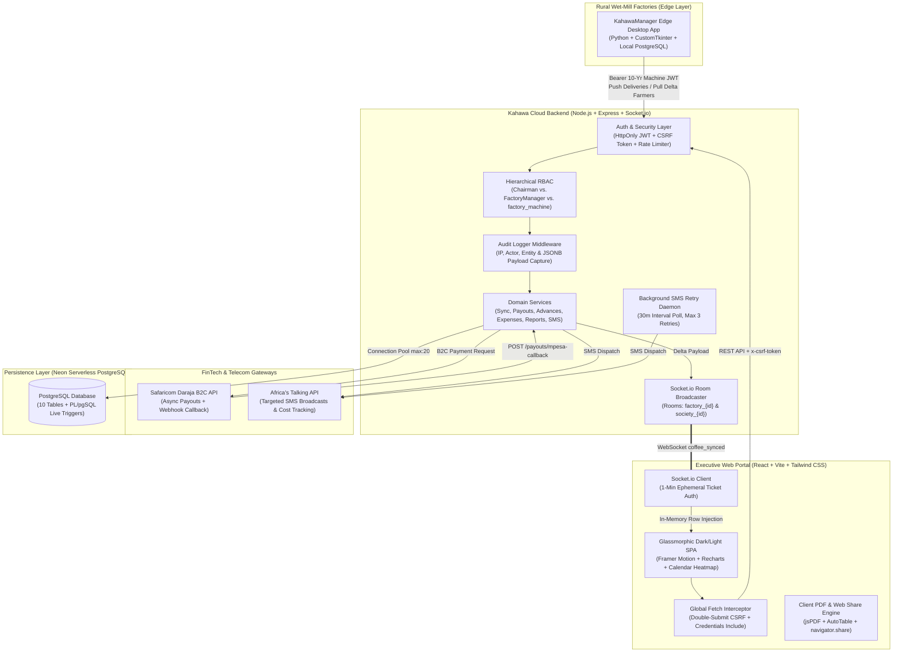
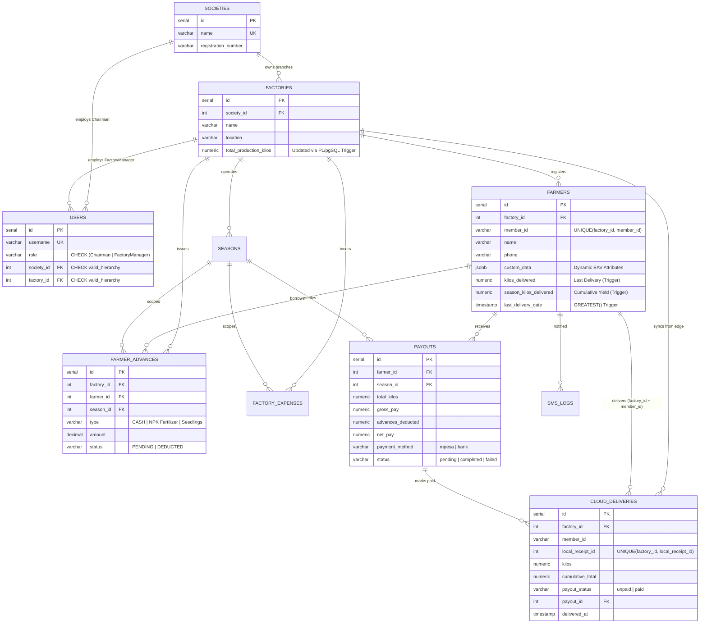
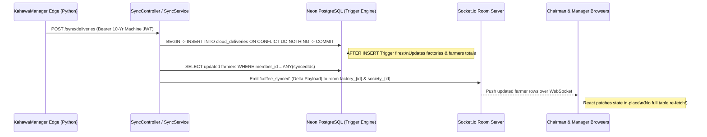

<div align="center">
  <h1>☁️ Kahawa Cloud ERP</h1>
  <p><strong>Multi-Tenant Agricultural Cooperative ERP, Real-Time Edge Telemetry Hub & Automated Farmer Payout Engine</strong></p>

  <p>
    
    
    
    
    
    
    
  </p>

  <p>
    <a href="#-executive-summary">Executive Summary</a> •
    <a href="#-the-problem--cooperative-scale">Domain Problem</a> •
    <a href="#-system-architecture">Architecture</a> •
    <a href="#-multi-tenant-database-schema-erd">Database Design</a> •
    <a href="#-core-engineering-highlights">Engineering Highlights</a> •
    <a href="#-platform-modules">Modules</a> •
    <a href="#-screenshots--interface-preview">Screenshots</a> •
    <a href="#-api-reference-overview">API Surface</a> •
    <a href="#-contact--codebase-walkthrough">Contact</a>
  </p>
</div>

---

> **📌 Note on Source Code Visibility:**  
> *Kahawa Cloud ERP is the centralized cloud control plane of the commercial **KahawaManager** ecosystem, and its primary source repository is private. This public repository serves as the **System Architecture & Engineering Case Study**, detailing the multi-tenant database design, real-time WebSocket delta-broadcasting, PL/pgSQL mathematical triggers, and M-Pesa B2C financial disbursement pipelines. Hiring managers, CTOs, and technical reviewers are welcome to [reach out](#-contact--codebase-walkthrough) for a live demo or codebase walkthrough.*

---

## 🚀 Executive Summary

**Kahawa Cloud ERP** is a full-stack, multi-tenant Enterprise Resource Planning (ERP) platform engineered for Kenyan coffee cooperative societies. While the companion desktop edge application (**KahawaManager Edge**) sits at rural wet-mill weighing stations reading physical scales offline, **Kahawa Cloud ERP** serves as the centralized executive command center for **Society Chairmen** and **Factory Managers**.

It ingests batch delivery payloads from distributed factory edge machines, updates society-wide yield totals in real time via **PostgreSQL PL/pgSQL triggers** and **Socket.io WebSocket delta streams**, tracks farm input advances (fertilizers, seedlings, cash loans), monitors factory operational expenses, dispatches targeted SMS broadcasts via **Africa's Talking**, and executes automated **End-of-Season Net Payouts** via **Safaricom M-Pesa Daraja B2C** and bulk bank CSV exports.

---

## 🌍 The Problem & Cooperative Scale

A single coffee cooperative society in Central Kenya typically oversees **multiple wet-mill factories**, each serving **thousands of smallholder farmers**. Managing this distributed hierarchy presents severe engineering and financial challenges:

1. **Fragmented Multi-Factory Visibility:**  
   Without a unified cloud ledger, a Cooperative Chairman has no real-time visibility into how much cherry is being weighed across 4–6 remote factories until physical ledgers or USB drives are brought to headquarters.
2. **Idempotent Edge-to-Cloud Synchronization over Flaky Networks:**  
   When rural factory internet flickers during a sync batch, edge machines retry sending delivery records. Without strict database-level idempotency guards, retried network requests create duplicate delivery records and inflate farmer payouts.
3. **Complex End-of-Season Net Payout Reconciliation:**  
   Throughout the 6–12 month harvest season, farmers take **Advances** (e.g., 50kg NPK Fertilizer bags, Ruiru 11 seedlings, or school-fee cash advances). At season close, calculating $\text{Gross Pay} = \sum \text{Unpaid Kilos} \times \text{Rate/KG}$, deducting all `PENDING` advances per farmer, preventing negative net balances, and disbursing payments to thousands of farmers via M-Pesa or bank transfers is error-prone when done manually.
4. **Strict Role-Based Data Isolation:**  
   A **Society Chairman** must view and audit aggregated metrics across all factories in their society, whereas a **Factory Manager** must be strictly sandboxed to their assigned factory branch.

---

## 🏗️ System Architecture

Kahawa Cloud ERP is built on a decoupled **PERN + Socket.io** architecture hosted across **Vercel** (Frontend SPA), **Render** (Node.js/Express API & WebSocket Server), and **Neon Serverless PostgreSQL**, with full **Docker & Docker Compose** containerization.



### Technology Stack Breakdown

| Layer | Technologies Used | Architectural Role |
| :--- | :--- | :--- |
| **Frontend SPA** | React, Vite, Tailwind CSS, Framer Motion, React Router | Responsive glassmorphic UI with Dark/Light mode, animated page transitions, and role-aware navigation. |
| **Analytics & Docs** | Recharts, Custom Calendar Heatmap, `jsPDF`, `jspdf-autotable` | Multi-timeframe area/bar charts, interactive 30-day delivery density heatmaps, slide-over daily ledger drawers, and branded PDF/CSV exports with native mobile `navigator.share`. |
| **Backend API & Real-Time** | Node.js, Express.js, `Socket.io`, `express-validator`, `express-rate-limit` | RESTful controllers, room-scoped WebSocket delta broadcasting (`factory_{id}` and `society_{id}`), and brute-force login protection. |
| **Database Engine** | PostgreSQL (Neon Serverless), `pg` Pool, `PL/pgSQL`, `JSONB` | Multi-tenant relational schema, self-healing connection pooling (`max: 20`), idempotent conflict shields, and zero-latency mathematical triggers. |
| **FinTech & Telecom** | Safaricom M-Pesa Daraja B2C, Africa's Talking SMS API, `axios` | Automated end-of-season mobile money payouts, asynchronous webhook reconciliation, and bulk/targeted farmer SMS alerts. |
| **Security & DevOps** | JWT (`HttpOnly` cookies), `bcrypt`, `crypto` (CSRF), Docker Compose | Double-Submit Cookie CSRF protection, 1-minute WebSocket handshake tickets, 10-year cryptographic Edge Machine licenses, and multi-container orchestration. |

---

## 🗄️ Multi-Tenant Database Schema (ERD)

The PostgreSQL schema (`SQL/kahawa.sql` & migrations) enforces a strict 3-tier cooperative hierarchy: **Societies** $\rightarrow$ **Factories** $\rightarrow$ **Farmers / Seasons / Deliveries / Advances / Expenses / Payouts**.



### Database-Level Constraints & Architectural Guards
1. **Hierarchical RBAC `CHECK` Constraint (`valid_hierachy`):**  
   Enforced directly inside PostgreSQL on the `users` table:
   ```sql
   CONSTRAINT valid_hierachy CHECK (
       (role = 'Chairman' AND society_id IS NOT NULL) OR 
       (role = 'FactoryManager' AND factory_id IS NOT NULL)
   )
   ```
2. **Scoped Composite Uniqueness (`UNIQUE (factory_id, member_id)`):**  
   Allows Factory A and Factory B within the same society to both have a Member `#001` without colliding, while guaranteeing a manager can never register duplicate member IDs within the same factory.
3. **Anti-Duplication Sync Shield (`UNIQUE (factory_id, local_receipt_id)`):**  
   Guarantees that if a rural factory's internet drops mid-sync and re-transmits the same batch of deliveries, `ON CONFLICT (factory_id, local_receipt_id) DO NOTHING` silently absorbs duplicates with zero data corruption.
4. **Partial Unique Index per Active Season:**  
   `CREATE UNIQUE INDEX idx_active_season_per_factory ON seasons(factory_id) WHERE is_active = TRUE` ensures a factory can have dozens of historical archived seasons but at most **one** active season at any moment.

---

## ⚙️ Core Engineering Highlights

### 1. Zero-Latency PL/pgSQL Mathematical Trigger Engine (`update_live_totals`)
Rather than running expensive `SUM()` aggregations across hundreds of thousands of delivery rows every time a Chairman loads the dashboard, the database computes rollups the exact millisecond an edge delivery lands in `cloud_deliveries`:

```sql
CREATE OR REPLACE FUNCTION update_live_totals()
RETURNS TRIGGER AS $$
BEGIN 
    -- 1. Atomically increment the factory's cumulative production
    UPDATE factories
    SET total_production_kilos = total_production_kilos + NEW.kilos
    WHERE id = NEW.factory_id;

    -- 2. Update the farmer's latest delivery, season cumulative total, and monotonic timestamp
    UPDATE farmers
    SET kilos_delivered = NEW.kilos,
        season_kilos_delivered = NEW.cumulative_total,
        last_delivery_date = GREATEST(COALESCE(last_delivery_date, '1970-01-01'::TIMESTAMP), NEW.delivered_at)
    WHERE factory_id = NEW.factory_id AND member_id = NEW.member_id;
        
    RETURN NEW;
END;
$$ LANGUAGE plpgsql;
```
Using `GREATEST(...)` ensures that even if an offline factory syncs older historical deliveries out of chronological order, `last_delivery_date` never regresses.

### 2. Real-Time Edge-to-Cloud Sync & WebSocket Delta Broadcasting
When a rural weighing station pushes deliveries or farmer updates to `/sync/deliveries` or `/sync/farmers`, the backend executes an ACID transaction (`BEGIN` ... `COMMIT`) and immediately triggers `broadcastDeltaPayload`:



* **Cross-Origin Ephemeral WebSocket Ticket Handshake:** Because the React SPA on Vercel and the Node.js WebSocket server on Render sit on different domains, browser `HttpOnly` cookies cannot easily authenticate direct cross-origin WebSocket upgrades. The frontend first calls `GET /auth/socket-ticket` to obtain a **1-minute short-lived JWT ticket**, then passes `{ auth: { ticket } }` into the `socket.io-client` handshake.
* **In-Place React Memory Patching:** When the browser receives a `FARMERS_UPDATED` delta payload over Socket.io, `FarmerDashboard` patches only the modified farmer rows directly in React state—updating weights and custom JSONB columns live on screen without a full API reload.

### 3. 3-Step End-of-Season Net Payout Engine & M-Pesa Daraja B2C
The Payouts module (`payout.service.js`, `payout.controller.js`) automates the most sensitive financial operation in the cooperative lifecycle:
1. **Non-Destructive Ledger Preview (`/payouts/preview`):**  
   Aggregates all `unpaid` deliveries for each farmer within the selected factory and date/season window, computes gross pay, queries all `PENDING` input/cash advances from `farmer_advances`, and computes net pay:
   $$\text{Gross Pay} = \left(\sum \text{Unpaid Kilos}\right) \times \text{Rate}_{\text{KES/KG}}$$
   $$\text{Net Pay} = \max\left(0,\; \text{Gross Pay} - \sum \text{Pending Advances}\right)$$
2. **Transactional Disbursement Lock (`disburse`):**  
   Inside a PostgreSQL `BEGIN ... COMMIT` transaction, the engine creates a `payouts` record and atomically transitions all constituent `cloud_deliveries` rows from `payout_status = 'unpaid'` to `'paid'` (linked via `payout_id`) so no delivery can ever be double-paid.
3. **Dual Disbursement Channels (Safaricom M-Pesa B2C & Bank CSV):**  
   * **M-Pesa B2C:** Authenticates with Safaricom Daraja OAuth, normalizes phone numbers to `2547XXXXXXXX`, dispatches `BusinessPayment` payloads, and exposes an unauthenticated `/payouts/mpesa-callback` webhook that reverts `cloud_deliveries` back to `'unpaid'` if a mobile money transfer fails.
   * **Bank Bulk Upload CSV:** Streams a formatted `Account_Number, Amount, Beneficiary_Name, Reference` CSV blob directly to the browser for cooperative bank batch processing.

### 4. Defense-in-Depth Security: Double-Submit CSRF + Cryptographic Machine Licenses
* **Global Fetch Interceptor & Double-Submit Cookie CSRF (`main.jsx`):**  
  Upon login, the server issues an `HttpOnly, Secure, SameSite` JWT cookie alongside a 32-byte cryptographic `csrfToken`. A custom global `window.fetch` wrapper automatically attaches `credentials: 'include'` and injects the `x-csrf-token` header on all mutating (`POST`, `PUT`, `DELETE`) requests, while dispatching a global `auth:unauthorized` event on `401`/`403` responses for instant session cleanup.
* **10-Year Edge Machine License Generator (`machine.service.js`):**  
  Chairmen and Factory Managers can provision a dedicated machine JWT (`role: 'factory_machine'`, `permissions: ['sync_deliveries']`, `expiresIn: '3650d'`) with one click in the Factory Table, copying the key directly to the clipboard for pasting into the rural desktop app's `config.ini`.

---

## 🧩 Platform Modules

* **🏭 Multi-Factory Command & Manager Provisioning (`/factories`):**
  * Society-wide KPI ribbon, branch registration, inline editing, **Chairman-only Factory Manager account creation**, and one-click **Edge Machine License Key** generation.
* **👨‍🌾 Dynamic EAV Farmer Directory (`/farmers`):**
  * Live WebSocket-connected farmer table with dynamic `JSONB` custom attribute columns (e.g., `Acres`, `Trees`, `Village`, `Bank Account`) automatically extracted and rendered via `parseCustomData`. Includes inline row editing, factory filtering, and branded PDF/CSV exports.
* **📈 3-Level Drill-Down Analytics & Calendar Heatmap (`/reports`):**
  * **Level 1 (Macro Trends):** Recharts `AreaChart` and `BarChart` views across `This Week`, `This Month`, `This Season`, and `Specific Year`.
  * **Level 2 (Tactical Calendar Heatmap):** Clicking a month bar drills into a custom 30-day **Calendar Density Heatmap** (`CalendarHeatmap.jsx`) color-coded by daily delivery volume relative to peak harvest day, complete with frosted-glass cursor-tracking tooltips.
  * **Level 3 (Slide-Over Daily Ledger Drawer):** Clicking any active day opens `DailyLedgerDrawer.jsx`, displaying every individual weighing transaction for that date with micro-metrics (`Volume`, `Tx Count`, `Avg KG`, `Max KG`), instant farmer search, and single-day PDF/CSV export.
* **🌱 Farmer Input & Cash Advances (`/advances`):**
  * Supports both **Unit $\times$ Quantity Inputs** (e.g., `2 x NPK Fertilizer 50kg @ KES 3,500` with `localStorage` unit-price memory) and **Flat Cash Advances**, with automatic category metric ribbons (`CASH`, `FERTILIZER`, `SEEDLING`).
* **💸 Factory Operational Expenses (`/expenses`):**
  * Season-scoped expense logging (`Electricity`, `Wages`, `Transport`, etc.) using dynamic `CreatableSelect` categories and role-isolated CRUD permissions.
* **📲 Targeted SMS Broadcasts & Auto-Retry Daemon (`/sms`):**
  * Compose broadcasts to **All Accessible Farmers**, a **Specific Factory**, or an **Individual Farmer** with live 160-character segment cost calculation, delivery status badges (`SENT`, `FAILED`, `BLACKLISTED`), and a 30-minute background retry daemon.
* **🗓️ Season Lifecycle Management (`/seasons`):**
  * Start new harvest seasons (automatically archiving prior active seasons per factory), monitor live season engagement metrics, and export or share branded **Season Summary PDFs** ranked by farmer yield.
* **🛡️ Compliance & System Audit Logs (`/audit`):**
  * Tracks `POST`, `PUT`, `DELETE`, `LOGIN`, `LOGOUT`, and `EXPORT` events with user role, IP address, timestamp, and an interactive **Raw Metadata / JSONB Request Payload Inspector Modal**.

---

## 📸 Screenshots & Interface Preview

<div align="center">
  <table>
    <tr>
      <td align="center" width="50%">
        
        <br />
        <em><strong>1. Glassmorphic ERP Portal Login:</strong> Role-aware authentication with brute-force rate limiting and Double-Submit CSRF protection.</em>
      </td>
      <td align="center" width="50%">
        
        <br />
        <em><strong>2. Multi-Factory Command Center:</strong> Society KPI ribbon, branch registration, manager onboarding, and 10-year Edge License Key generator.</em>
      </td>
    </tr>
    <tr>
      <td align="center" width="50%">
        
        <br />
        <em><strong>3. Real-Time Farmer Directory:</strong> WebSocket delta-updated table with dynamic JSONB custom columns, advance balances, and PDF/CSV export.</em>
      </td>
      <td align="center" width="50%">
        
        <br />
        <em><strong>4. Harvest Season Lifecycle:</strong> Active season telemetry, historical season archives, and one-click Season Summary PDF generation.</em>
      </td>
    </tr>
    <tr>
      <td align="center" width="50%">
        
        <br />
        <em><strong>5. Farmer Advances (Inputs & Loans):</strong> Track fertilizer, seedling, and cash advances with automatic unit-price memory.</em>
      </td>
      <td align="center" width="50%">
        
        <br />
        <em><strong>6. Factory Operational Expenses:</strong> Category-grouped expense ribbons and season-scoped cost tracking.</em>
      </td>
    </tr>
    <tr>
      <td align="center" width="50%">
        
        <br />
        <em><strong>7. SMS Broadcast Center:</strong> Society, factory, or individual farmer SMS dispatch with segment counter and Africa's Talking logs.</em>
      </td>
      <td align="center" width="50%">
        
        <br />
        <em><strong>8. End-of-Season Net Payout Engine:</strong> 3-step payout calculator with automatic advance deduction, M-Pesa B2C disbursement, and Bank CSV export.</em>
      </td>
    </tr>
    <tr>
      <td align="center" width="50%">
        
        <br />
        <em><strong>9. Yield Analytics & Calendar Heatmap:</strong> Recharts delivery timelines paired with a 30-day delivery density heatmap.</em>
      </td>
      <td align="center" width="50%">
        
        <br />
        <em><strong>10. Daily Ledger Drawer:</strong> Granular per-day weighing transactions, micro-metrics (Volume, Tx, Avg, Max), and instant PDF export.</em>
      </td>
    </tr>
    <tr>
      <td align="center" width="50%">
        
        <br />
        <em><strong>11. System Audit Trail:</strong> Role-scoped activity monitoring with user, action, entity, IP address, and date-range filters.</em>
      </td>
      <td align="center" width="50%">
        
        <br />
        <em><strong>12. Audit Metadata Inspector & Dark Theme:</strong> Raw JSONB request payload inspection modal and full dark-mode support.</em>
      </td>
    </tr>
  </table>
</div>

---

## 📡 API Reference Overview

The Express backend exposes **12 modular route groups** protected by JWT verification, hierarchical RBAC (`isAdmin`, `isSuperAdmin`), and audit logging:

| Domain | Base Route | Key Endpoints & Capabilities |
| :--- | :--- | :--- |
| **Authentication** | `/auth` | `POST /login` (rate-limited 5/15m), `POST /logout`, `POST /register`, `POST /register-manager`, `GET /socket-ticket` (1m WebSocket JWT). |
| **Edge Synchronization** | `/sync` | `POST /deliveries` (idempotent batch ingest + Socket.io broadcast), `POST /farmers`, `GET /pull-farmers`, `POST /seasons`, `GET /pull-seasons`, `GET /health`. |
| **Factories** | `/factories` | `GET /`, `POST /add`, `PUT /edit/:id`, `DELETE /delete/:id`, `GET /metrics` (Chairman-scoped society branch management). |
| **Machine Licensing** | `/machines` | `POST /generate-license` (Issues 10-year `factory_machine` JWT for rural edge desktop clients). |
| **Farmers** | `/farmers` | `GET /` (with live `PENDING` advances subquery), `POST /add`, `PUT /edit/:id`, `DELETE /delete/:id` (soft-delete `is_active = FALSE`). |
| **Seasons** | `/seasons` | `GET /`, `GET /:id/farmers` (ranked season yield), `POST /add` (transactional season rollover), `PUT /archive/:id`. |
| **Farmer Advances** | `/advances` | `GET /`, `GET /types`, `POST /`, `GET /farmer/:farmer_id/balance`, `PUT /:id/status`, `DELETE /:id`. |
| **Factory Expenses** | `/expenses` | `GET /`, `POST /`, `PUT /:id`, `DELETE /:id` (FactoryManager branch-isolated or Chairman society-wide). |
| **End-of-Season Payouts**| `/payouts` | `POST /preview` (Gross - Advances math), `POST /disburse` (Safaricom M-Pesa B2C), `POST /bank-csv`, `POST /mpesa-callback` (Daraja webhook). |
| **Analytics & Reports** | `/reports` | `GET /yield-by-factory`, `GET /timeline` (week, month, season, year), `GET /daily-ledger` (granular date drill-down). |
| **Global Metrics** | `/metrics` | `GET /` (Role-scoped total farmers and cumulative season yield). |
| **SMS & Audit** | `/sms`, `/audit` | `POST /sms/send`, `GET /sms/logs`, `GET /audit`, `POST /audit/export`. |

---

## 📂 Project Directory Structure

```text
kahawa-Dashboard/
├── SQL/
│   ├── kahawa.sql                        # Core multi-tenant schema, constraints & PL/pgSQL triggers
│   ├── 001_neon_advances_migration.sql   # Farmer advances table, indexes & timestamp triggers
│   ├── 002_expenses_migration.sql        # Factory operational expenses schema
│   └── sms_migration.sql                 # SMS logs & background retry index
├── backend/
│   ├── server.js                         # Express + Socket.io server & room handshake authentication
│   ├── config/
│   │   └── db.js                         # Resilient pg.Pool (Neon SSL + auto-reconnect on idle drop)
│   ├── middleware/
│   │   ├── verifyToken.js                # Cookie / Bearer JWT verification
│   │   ├── auth.middleware.js            # Role guards (isAdmin, isSuperAdmin) & CSRF verification
│   │   └── auditLogger.js                # Automated request/action/IP audit trail interceptor
│   ├── controllers/                      # 12 modular REST controllers
│   ├── services/                         # 12 domain services (ACID transactions, Socket delta emit, SMS daemon)
│   ├── routes/                           # 12 Express routers with express-validator chains
│   ├── utils/
│   │   └── mpesa.js                      # Safaricom Daraja OAuth token generator
│   └── Dockerfile                        # Production Node.js container definition
├── frontend/
│   ├── src/
│   │   ├── main.jsx                      # Global fetch CSRF interceptor & auth event dispatcher
│   │   ├── App.jsx                       # Animated route shell & glassmorphic toast provider
│   │   ├── context/AuthContext.jsx       # Persistent RBAC & session state manager
│   │   ├── components/
│   │   │   ├── layout/Navbar.jsx         # Role-adaptive top navigation & Dark/Light mode engine
│   │   │   └── shared/
│   │   │       ├── CalendarHeatmap.jsx   # Interactive 30-day delivery density matrix
│   │   │       └── DailyLedgerDrawer.jsx # Slide-over transaction ledger with micro-metrics & PDF export
│   │   ├── pages/                        # 9 feature dashboards (Factories, Farmers, Seasons, Advances, Expenses, Payouts, Analytics, Sms, Audit)
│   │   └── utils/
│   │       ├── dataParser.js             # Safe JSONB custom_data parser
│   │       └── pdfUtils.js               # Branded jsPDF + AutoTable generator & Web Share API wrapper
│   ├── vercel.json                       # SPA routing configuration
│   └── Dockerfile                        # Frontend container definition
└── docker-compose.yml                    # Full-stack multi-container orchestration
```

---

## 📬 Contact & Codebase Walkthrough

I designed, architected, and built the entire **KahawaManager Ecosystem** (both the **Python Edge Weighing Station** and this **PERN + Socket.io Cloud ERP**), and pitched it directly to coffee cooperative society boards in Murang'a and Central Kenya.

If you are a **recruiter, hiring manager, CTO, or engineering lead** interested in:
* A live end-to-end demonstration of an Edge Weighing Station syncing in real time to the Cloud ERP over WebSockets
* Walking through the private repository, PL/pgSQL triggers, and M-Pesa B2C payout architecture
* Full-Stack, Backend, or Distributed Systems engineering opportunities

**Let's connect:**
* 👤 **Engineer:** Ian Wabacha Kimani
* 📧 **Email:** [kimaniian273@gmail.com](mailto:kimaniian273@gmail.com)
* 📞 **Phone / WhatsApp:** +254 115 605 780
* 🐙 **GitHub:** [@ian-kimani](https://github.com/ian-kimani)
* 💼 **LinkedIn:** [(https://linkedin.com/in/ian-wabacha)]

---

<div align="center">
  <p><em>Architected & Engineered by <strong>Ian Wabacha Kimani</strong> • © 2026 All Rights Reserved</em></p>
</div>
